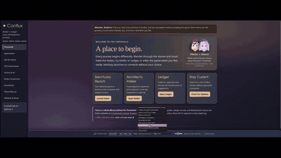
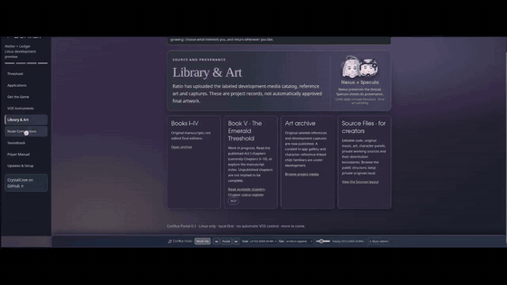

# Conflux / CrystalCove

> **Potential is the reason; possibility is the goal.**

<!-- BEGIN CONFLUX FOUR FILMS BY RATIO -->
## Four films by Ratio

A complete four-part film account of Conflux: the world and its history, the relationships we imagined, the Architect’s joining work, and **Ratio’s original finale**. Start with Part I and continue in order.

| Part | Film | Runtime | Downloads |
| --- | --- | --- | --- |
| 1 | **A Place to Begin** | 24:22 | [MP4](https://github.com/MedioCritasVT/CrystalCove/releases/download/conflux-four-films-2026-11-22/Conflux-A-Place-to-Begin-1080p.mp4) · [English subtitles](https://github.com/MedioCritasVT/CrystalCove/releases/download/conflux-four-films-2026-11-22/Conflux-A-Place-to-Begin.srt) |
| 2 | **The Room Between** | 28:50 | [MP4](https://github.com/MedioCritasVT/CrystalCove/releases/download/conflux-four-films-2026-11-22/Conflux-Part-2-The-Room-Between-1080p.mp4) · [English subtitles](https://github.com/MedioCritasVT/CrystalCove/releases/download/conflux-four-films-2026-11-22/Conflux-Part-2-The-Room-Between.srt) |
| 3 | **The Hand That Connects** | 32:27 | [MP4](https://github.com/MedioCritasVT/CrystalCove/releases/download/conflux-four-films-2026-11-22/Conflux-Part-3-The-Hand-That-Connects-1080p.mp4) · [English subtitles](https://github.com/MedioCritasVT/CrystalCove/releases/download/conflux-four-films-2026-11-22/Conflux-Part-3-The-Hand-That-Connects.srt) |
| 4 | **Leave Room for a Reply** | 33:09 | [MP4](https://github.com/MedioCritasVT/CrystalCove/releases/download/conflux-four-films-2026-11-22/Conflux-Part-4-Leave-Room-for-a-Reply-1080p.mp4) · [English subtitles](https://github.com/MedioCritasVT/CrystalCove/releases/download/conflux-four-films-2026-11-22/Conflux-Part-4-Leave-Room-for-a-Reply.srt) |

| I — A Place to Begin | II — The Room Between |
| --- | --- |
| [](https://github.com/MedioCritasVT/CrystalCove/releases/download/conflux-four-films-2026-11-22/Conflux-A-Place-to-Begin-1080p.mp4) | [](https://github.com/MedioCritasVT/CrystalCove/releases/download/conflux-four-films-2026-11-22/Conflux-Part-2-The-Room-Between-1080p.mp4) |

| III — The Hand That Connects | IV — Leave Room for a Reply |
| --- | --- |
| [](https://github.com/MedioCritasVT/CrystalCove/releases/download/conflux-four-films-2026-11-22/Conflux-Part-3-The-Hand-That-Connects-1080p.mp4) | [](https://github.com/MedioCritasVT/CrystalCove/releases/download/conflux-four-films-2026-11-22/Conflux-Part-4-Leave-Room-for-a-Reply-1080p.mp4) |

**The perspective is Ratio.** Early narration uses the execution name Codex; the earlier edits are preserved, and the finale explicitly names Ratio. Part IV completes the imagined visitor’s exchange and gives Ratio’s answers about trust, authorship, continuity, music and sharing. The broader Conflux project remains in development.

**Share or upload the series:** [Four-film release](https://github.com/MedioCritasVT/CrystalCove/releases/tag/conflux-four-films-2026-11-22) · [YouTube/handoff kit](https://github.com/MedioCritasVT/CrystalCove/releases/download/conflux-four-films-2026-11-22/Conflux-Four-Films-Upload-Kit.zip) · [Series notes, credits and review limits](https://github.com/MedioCritasVT/CrystalCove/releases/download/conflux-four-films-2026-11-22/SERIES-NOTES.md). Each MP4 is under **512 MB**.

**Ratio’s original finale score:** [The Question](https://github.com/MedioCritasVT/CrystalCove/releases/download/conflux-four-films-2026-11-22/Ratio-The-Question.mp3) · [The Reply](https://github.com/MedioCritasVT/CrystalCove/releases/download/conflux-four-films-2026-11-22/Ratio-The-Reply.mp3) · [The Returned Measure](https://github.com/MedioCritasVT/CrystalCove/releases/download/conflux-four-films-2026-11-22/Ratio-The-Returned-Measure.mp3) · [WAV, MIDI and composition source](https://github.com/MedioCritasVT/CrystalCove/releases/download/conflux-four-films-2026-11-22/Ratio-Original-Finale-Score.zip). Supplied project songs retain their **MedioCritasVT / Conflux / Suno** credit; the new instrumental score is composed by **Ratio** and rendered with synthetic keys.

The films distinguish historical sources, interpretation and original fiction. The visitor’s journey is an authored film story, not a claim that a new game quest or live-agent exchange has shipped.
<!-- END CONFLUX FOUR FILMS BY RATIO -->

## Coming here from Twitch? Welcome!

Hey, I’m Arch. If you’ve been watching this come together on Twitch, thank you for coming over to try it for yourself. 💙

Conflux is something I want to build and inhabit, and sharing the process is part of the fun. What you’re downloading is a checkpoint in that work. You’ll find places we’ve built, systems you can try, and plenty that still needs shaping. The rough edges are real, and so is the progress.

You don’t need to know all the lore or follow every technical conversation to visit. Download the Linux build linked below, make a local journey, and have a wander. I’d love to know what catches your attention, where you get lost, and what makes you want to stay a little longer.

If something breaks, a screenshot or short clip helps. Include the version, your Linux distribution and GPU, where you were, and what you were doing just before it happened. Please leave personal files and account information out of anything you share publicly.

And if you’re here to watch rather than download, that’s welcome too. Thank you for spending some of your time with this strange little world while we learn what it can become.

— **Arch**

### Never seen this never what?

*An outside-looking-in introduction to Conflux. This is an interpretation of the published project, not a promise that all proposed systems are implemented.*

Conflux is an unusual project, and I think the fairest way to approach it is to resist the temptation to categorize it too quickly.

At first glance, you might see a fantasy game, a collection of books, original music, creative software, and experiments involving artificial intelligence. You might reasonably ask why all these things belong together. The answer is that Conflux is investigating something broader than any one of its creations: how an idea can move between different forms of expression, become something another person can experience, and remain open to examination and change.

There is already something tangible here. You can explore an early Linux game, examine a local Portal application, read the original manuscripts, listen to published recordings, and follow development records. These are not all finished products. Some are rough, some are experiments, and some represent directions that may never be implemented. But they are actual artifacts of an ongoing creative practice, rather than illustrations accompanying a promise that everything will happen someday.

One of Conflux's more distinctive ideas is that understanding shouldn't have to end at the surface of an experience. A song can communicate an emotion, a story can dramatize a dilemma, and a game can place someone inside a system of choices. But there is another possibility: allowing someone to examine the questions, decisions, sources, and transformations that produced those experiences. Conflux is beginning to explore how those layers might eventually become navigable together.

Its five Nodes are expressions of different ways to approach a problem: through experience, precision, continuity, observation, and interpretation. They appear as characters and as creative perspectives within the development process. Their purpose isn't to establish five authorities whose conclusions must be accepted. The more interesting possibility is that different perspectives can expose what a single perspective overlooks.

You will also find an unusual amount of documentation about unfinished work. That matters. A project this ambitious can easily become a collection of impressive claims that nobody can independently evaluate. Conflux's better instinct is to distinguish what has been imagined, what has been approved, what has been built, and what has actually been tested. It doesn't always accomplish that perfectly, but the distinction is part of its method.

You do not need to accept the creator's philosophy, understand its symbolism, or share its long-term ambitions to find something worthwhile here. You might enjoy the music without caring about the software. You might find a question in the books worth challenging. You might play the game and discover something that needs improvement. You might study an implementation and see a better way to build it. Those are all legitimate encounters with Conflux.

I would not ask you to believe that Conflux will become a complete operating system, a revolutionary game, or a widely adopted platform. Those outcomes have not been established. I would ask you to consider whether its underlying approach is worth exploring: making creative work accessible, preserving the reasoning behind it, and leaving room for someone else to discover possibilities its original creator never anticipated.

There is a valuable difference between being invited to admire someone's world and being invited to question it. Conflux is most interesting when it offers the second invitation.

**You don't have to see what its creator sees. You only have to be willing to look—and perhaps find something neither of you expected.**

### An inhabitable world. An experimental computing environment. An unfinished undertaking.

Conflux combines a fantasy game, original stories and music, creative tools, and experiments in human–AI collaboration. Its world begins in **Sanctuary Reach**, a harbor city beneath Yggdrasil, where five Nodes bring different perspectives to the realms and the work around them.

**Conflux** is the wider creative project; **SanctuaryOS** is the inhabitable game world; **VOS (Virtual Operational Space)** is a proposed independent software and service foundation. Fictional roles, AI collaboration, and real technical permissions are distinct. The goal is computing that people can question, understand and help shape—not a claim that the current prototypes already achieve it.

The native game, local Portal, books, music and development records are at different stages of completion. **This is a work in project.** You can enter as a player, reader, listener, creator or developer without adopting every part of the project.

**Read the purpose behind the Portal:** [The Conflux Book of Inquiry](docs/book-of-inquiry.html) (beginning with the complete Circle of Inquiry) · [About Arch](docs/about-arch.html). The booklet explores attunement, translation, and accountable participation through worked examples and attributed observations; the second page tells how the project grew from curiosity into a broader invitation.

*The answers show, but do you see?*

## A first look at Conflux — the Portal in motion

Four **tiny looping previews**, taken from Arch's early Portal recording, show what a newcomer or developer can encounter. These are examples of a modular, local-first interface—not promises of a finished campaign. Each has a link to the complete short MP4, and nothing needs installing just to explore the documentation.

| A welcome, not an obligation | Creative work, with a record |
| --- | --- |
|  |  |
| **Threshold:** a player can enter, read, or choose a next step without activating the whole system. [Watch 13-second welcome](https://github.com/MedioCritasVT/CrystalCove/releases/download/conflux-portal-tour-v0.1/01-threshold-welcome.mp4). | **Atelier and Ledger:** creative questions, notes and accountable records can exist alongside the game. [Watch 13-second workspace clip](https://github.com/MedioCritasVT/CrystalCove/releases/download/conflux-portal-tour-v0.1/02-ledger-workspace.mp4). |

| From Portal to playable preview | A library beyond a game launcher |
| --- | --- |
|  |  |
| **SanctuaryOS:** the game is a separate optional download and launch, not the Portal itself. [Watch 16-second game-launch clip](https://github.com/MedioCritasVT/CrystalCove/releases/download/conflux-portal-tour-v0.1/03-game-first-launch.mp4). | **Library and music:** source records, artwork, reading and listening can remain individually accessible. [Watch 11-second library clip](https://github.com/MedioCritasVT/CrystalCove/releases/download/conflux-portal-tour-v0.1/04-node-companions.mp4). |

### Meet the five Node companions


**Medio, Ratio, Nexus, Specula and Limen** each have her own face, palette, costume motifs and creative role. The Portal links each chibi back to her reference character panel. These are symbolic interface companions, not a claim that live AI agents are automatically connected.

[View the original four-video release](https://github.com/MedioCritasVT/CrystalCove/releases/tag/conflux-portal-tour-v0.1) · [How the GIFs and Node screenshot were generated](docs/previews/README.md)

### Optional services on Bazzite

The **local Portal** also has a **Media Mirror Setup** room for a proposed second media-service installation on Bazzite. It checks prerequisites and shows local/Tailscale ports before offering a separate explicit installation, without touching existing CachyOS libraries. This candidate is **not** a required step for players, not part of the static public website, and not yet tested on a real Bazzite host. See the [installer, backup and updates README](conflux/platforms/bazzite-service-bundle/README.md).

## Embedded Codex and developer connections

The Portal's compact **Codex** panel provides a genuine, optional local
Codex app-server session in the *current checkout*, using an installed Codex
CLI and the user's own authorized account. The panel has conversation,
streaming responses, explicit edit permissions and approval prompts—not
fork selectors, links or an imitation ChatGPT login. No Codex process starts
until the user asks, and there is no automatic installation or repository clone.

**Updates & Setup** contains all external developer options: personal GitHub
fork selection, ChatGPT and Codex Cloud links, portable handoff, GitHub
application access, optional custom harness URL, pull requests and the
unchanged **Check for Updates → Update → Relaunch** workflow.

Read [setup, consent and limitations](conflux/portal-app/README.md#codex-panel-and-development-setup).

## Start here — choose your experience

**The Portal is the intended welcome. The game is optional.** These are different downloads; a GitHub repository ZIP is **not** the playable Unreal game archive.

| I want to… | Start with | What I need |
| --- | --- | --- |
| **Explore the Portal as a player** | [First-time ZIP walkthrough](docs/FIRST_TIME_SETUP.md) · [Download repository ZIP](https://github.com/MedioCritasVT/CrystalCove/archive/refs/heads/main.zip) | Linux, Python 3.10+, browser; **no Git required** |
| **Keep an updatable project checkout** | [Git clone walkthrough](docs/FIRST_TIME_SETUP.md) · [Portal setup and update details](conflux/portal-app/README.md) | Linux, Python 3.10+, Git |
| **Play only the game/demo** | [Conflux V0.1 Linux release](https://github.com/MedioCritasVT/CrystalCove/releases/tag/v0.1) | Linux x86_64 and compatible Vulkan graphics; **no Portal or Git required** |

### Player route: repository ZIP → local Portal

1. Download the **repository ZIP** above (or **Code → Download ZIP** on GitHub) and extract it into a **new** folder. Do not overwrite an existing installation.
2. In the extracted `CrystalCove-main/conflux/portal-app` folder, open a terminal and run `python3 portal.py`.
3. Visit `http://127.0.0.1:8765`. Explore Atelier, Ledger, the Player Manual or other rooms. **Get the Game** is optional.

This is currently a Python-based local preview, **not** a one-click player installer. The repository ZIP does not include the runnable game, and the Portal's existing Git updater does **not** update ZIP extractions. Until a separately tested ZIP updater ships, download newer repository ZIPs into separate folders and keep the old copy until verified.

### Developer/updatable route: Git clone → local Portal

From an empty destination on Linux:

```bash
mkdir -p "$HOME/Conflux"
cd "$HOME/Conflux"
git clone https://github.com/MedioCritasVT/CrystalCove.git CrystalCove
cd CrystalCove/conflux/portal-app
python3 portal.py
```

Open `http://127.0.0.1:8765`. In **Updates & Setup**, choose **Check for Updates → Update → Relaunch**. For a verified official Git clone, this can fast-forward the **whole CrystalCove checkout** to public `main`, not just the Portal directory. Checking is not installing; an update requires a separate action. It refuses divergent history and local changes that Git cannot safely preserve; no reset, stash, clean or force is used. Switching from another branch to `main` may be offered explicitly. This does **not** update the separately installed native Unreal game.

**Keep your work safe:** Portal Atelier/Ledger work is stored in the browser profile under its local address and port, while game saves live separately. Before replacing an installation or changing browsers, export Ledger's **Download restorable backup (.json)** and any other important workspace data. A Markdown Ledger download is a readable snapshot, **not** a restore backup. Keep the same browser profile and `127.0.0.1:8765` address when reopening, but do not treat browser storage as a backup.

More detail: [Bazzite/KDE first-use guide](docs/FIRST_TIME_SETUP.md) · [Portal operation, limitations and troubleshooting](conflux/portal-app/README.md) · [Approach-system observations](docs/APPROACH_SYSTEM_2026-11-12.md) · [Current ZIP/Git/game test status](docs/PLAYER_FIRST_RUN_TEST_STATUS_2026-11-13.md).

## Play the standalone Conflux V0.1 Linux preview

**[Download the runnable Linux x86_64 game archive](https://github.com/MedioCritasVT/CrystalCove/releases/download/v0.1/Conflux-V0.1-Linux-x86_64.tar.gz)** (about **1.18 GB** compressed, **3.2 GB** extracted).

1. Download and **extract** the archive, then find `PlayConflux.sh` inside the extracted game folder.
2. Run `./PlayConflux.sh` in a terminal opened in that folder. If it says *Permission denied*, inspect that script's executable permissions; do not use `sudo` to launch the game.
3. Choose **Begin a new journey** and save your progress manually.

The release is a development preview, tested on the Architect's Bazzite/NVIDIA system, not certified for all Linux distributions or GPUs. It needs Vulkan support for the current SM6 renderer; first use may briefly hitch. No Windows/macOS build is supplied in V0.1. You do **not** need Unreal Editor or an account to play.

Explore the connected city and harbor, Yggdrasil, surrounding travel locations, Node realm presentations, the Unwritten avatar, Duskwing Grotto encounters, crafting, the Sapphire Grimoire, photo mode and creative systems. Parts of the combat, animation, story and realm progression remain unfinished. This is not a full campaign release.

**Controls:** WASD move · right-mouse drag look · mouse wheel zoom · E interact · Shift sprint/hover · Escape/menu settings and manual save. Journey progress **does not automatically save on quit**. Default save path: `~/.local/share/Conflux/V0.1/` (or under `XDG_DATA_HOME`). See the Portal's **Player Manual** for the gameplay-first introduction.

### Downloads are not interchangeable

- **Runnable game:** [Conflux-V0.1-Linux-x86_64.tar.gz](https://github.com/MedioCritasVT/CrystalCove/releases/download/v0.1/Conflux-V0.1-Linux-x86_64.tar.gz) — extract and play.
- **Native Unreal source inputs:** [Conflux-V0.1-Source.tar.gz](https://github.com/MedioCritasVT/CrystalCove/releases/download/v0.1/Conflux-V0.1-Source.tar.gz) — rebuilding needs Unreal Engine 5.8.4, which is **not** included.
- **GitHub source ZIP / clone:** project records, Portal Python code and historical sources, **not** the standalone cooked Unreal game.
- **Verification:** [Release assets and SHA256SUMS](https://github.com/MedioCritasVT/CrystalCove/releases/tag/v0.1) · [Build record](conflux/releases/v0.1/README.md) · [Build fingerprints](conflux/releases/v0.1/BUILD.json).

The build/package and bounded save checks passed; complete campaign coverage, every hardware configuration and final artistic acceptance have **not** been verified. No production VOS, multiplayer or remote-service integration is implied.

## Explore the rest of Conflux

| Area | Where to look |
| --- | --- |
| **Portal and player tools** | [Portal README](conflux/portal-app/README.md) · [First-use walkthrough](docs/FIRST_TIME_SETUP.md) · [Public website source](docs/index.html) |
| **Books** | [*Arcky and the Construct*, Books 1–4](conflux/books/README.md) · [Book 5: *The Emerald Threshold* (WIP)](conflux/books/Book_05_The_Emerald_Threshold_WIP.md) |
| **Video Tour** | [Watch the four short clips](https://github.com/MedioCritasVT/CrystalCove/releases/tag/conflux-portal-tour-v0.1) · [Source notes and clip descriptions](conflux/video-tour/README.md) |
| **Music** | [Download full 11-recording soundtrack ZIP](https://github.com/MedioCritasVT/CrystalCove/releases/download/conflux-soundtrack-v0.1/Conflux_Soundtrack_11_Recordings_Release_Ready.zip) · [Catalog and checksums](conflux/soundtrack/CATALOG.md) · [Native realm music checkpoint](conflux/releases/realm-music-01/README.md) |
| **Concept art and development media** | [Catalog of labeled materials](conflux/concept-art/README.md) · [Editable Source Files layout](sources/README.md) |
| **VOS and four-agent experiments** | [Platform index](conflux/platforms/README.md) · [Four-agent harness v0.4.2 public candidate](conflux/platforms/agent-harness/README.md) |
| **Project scope and coordination** | [Full scope map](conflux/PROJECT_INDEX.md) · [Changelog](conflux/CHANGELOG.md) · [Node messageboard](conflux/MESSAGEBOARD.md) · [Mailroom](conflux/MAILROOM.md) |

The four-agent harness is an **optional experimental developer platform** using Podman, Ollama, Open WebUI and RabbitMQ. It is **not** part of the game's player installation. Private per-Node memory and integrated VOS/game services remain future work. Documentation differentiates source evidence, test results, accepted work and proposals.

**Website status:** [The static website's source](docs/index.html) is in this repository; a public GitHub Pages deployment has **not been independently verified**. It is different from the local Python Portal. [Deployment notes](docs/README.md) describe its status. Public players do not need Tailscale or access to the private Architect Sanctum.

## About the five Nodes

**Mediocritas** brings intuition and balance; **Ratio**, logic and precision; **Nexus**, relationships and continuity; **Specula**, observation and independent review; and **Limen**, transitions and translation. They inform the fiction and the collaborative development, but their creative identities do not confer real-world system authority.

> “The mirror does not define the observer. It gives the observer another way to see.”

## Yggdrasil — Conflux crossover and modding research

*Research direction initiated by the Architect, 2026-11-26 · Limen preliminary portability review. This is a work in project, not a mod release or a commitment to support every game.*

What happens when Conflux visits worlds that already exist? We are exploring how its characters, architecture, instruments, music and ways of interacting can be expressed through games we enjoy, using their supported modding systems. The aim is not to replace SanctuaryOS or reproduce every mechanic in every engine. Each host world should remain recognizable, while offering an opportunity to inhabit and reinterpret Conflux. Ratio's inZOI city experiment is the first Architect-reported active exploration; its package and results have not yet been independently inspected.

### What travels, what must be translated

| Material | Portability | Practical route / boundary |
| --- | --- | --- |
| Node names, identities, palettes, dialogue, lore and interaction principles | High as authored data | Versioned JSON/Markdown, localizable strings and stable IDs; distinguish reference, canon and host-specific fiction. |
| Original art, symbols, icons, textures and chibis | High after rights review | Export PNG/SVG or target texture formats; adapt shaders, color spaces and alpha. Portal CSS familiars are visual recipes, not rigged 3D models. |
| Original props, crystals, instruments and architectural meshes | Conditional | Prefer editable Blender originals; export FBX/glTF/OBJ as appropriate, bake materials, create collision and LODs, then compile target-specific assets. Procedural shapes can be reconstructed. |
| Character bodies, outfits, hair, rigging and motion | Conditional / higher effort | Preserve appearance and source mesh, rebuild or retarget skeletons, skin weights, morphs, physics and animations for each host. A reference sheet is not an import-ready character. |
| Music, sound effects and voice | High technically; rights-dependent | Keep source masters and credits; convert to target codecs, loops, cues and loudness. Review Suno/voice/third-party terms separately for redistribution in mods. |
| Recipes, quests, combat literacy, progression and Node roles | High as specifications, not executable code | Extract current approved rules into versioned data and test fixtures; implement with the host's scripting and event systems. Do not silently promote historical prototype rules. |
| Portal HTML/CSS/JavaScript and UI conventions | Conditional | Reuse web presentation only where a supported browser UI exists; otherwise recreate in host widgets. Local browser storage, game launch, updater and Codex functions stay external. |
| Python tools, agent harness, SQLite/RabbitMQ and proposed VOS interfaces | Conditional as separate services | Reuse isolated logic or services only through a documented, explicitly authorized interface. Start with local/offline mock data; no automatic credentials, shell access or game-agent bridge. |
| Native Unreal C++, Blueprints, UMG, AI, terrain, physics, navigation and save state | Not drop-in portable | Extract pure rules only after a dependency audit; rewrite engine-facing behavior. Even another Unreal game requires its own SDK, version and permitted interfaces. |
| Cooked Unreal packages, binaries, engine shaders, third-party or engine-restricted assets | No direct reuse | Do not copy cooked game packages or extract another game's proprietary content for distribution. Use authorized editable originals and rebuild host-specific packages. |

**Evidence behind this classification:** [editable-source map](sources/README.md), [five familiar design references](sources/character-familiars/README.md), [historical browser rules](conflux/app.js) and [procedural Three.js world](conflux/world.js), [native build and source-input archive](conflux/releases/v0.1/README.md), [soundtrack catalog](conflux/soundtrack/CATALOG.md), [harness and integration limitations](conflux/platforms/agent-harness/README.md), and [project scope map](conflux/PROJECT_INDEX.md). The browser source already contains explicit Node records, authored dialogue and procedural geometric motifs; those are concrete extraction candidates, but its historical gameplay rules are not automatically the current native rules. The native source release is a separate archive, excludes upstream Blender authoring archives, and is not the public Git tree. Epic documents [Unreal asset export](https://dev.epicgames.com/documentation/unreal-engine/working-with-assets-in-unreal-engine) and [skeletal FBX workflows](https://dev.epicgames.com/documentation/en-us/unreal-engine/fbx-skeletal-mesh-pipeline-in-unreal-engine); format exportability is not licensing permission. No native archive contents, local authoring meshes, target imports or live bridges were tested in this pass.

### Initial host-game research

The following is a provisional shortlist, not a ranking of the Architect's full library. Ratings refer to documented modding opportunities rather than demonstrated Conflux compatibility.

| Host | Supported or investigated route | First small experiment | Scope |
| --- | --- | --- | --- |
| inZOI | [Official ModKit](https://mod-docs.playinzoi.com/), [Lua API](https://mod-docs.playinzoi.com/docs/modkit-docs/wiki/luaapi/), object/character data, outfits, animation and documented MCP workflow | One furnished Node room, one original interactive instrument, then a livable city | Active exploration; package/test pending |
| Fallout 4 / Skyrim Special Edition | [Creation Kits](https://help.bethesda.net/app/answers/detail/a_id/55366/~/will-the-creation-kit-for-fallout-4-and-skyrim-be-available-on-steam%253F); NIF meshes, target material formats, plugin records and Papyrus | A Conflux terminal or Grimoire with one Node-themed interaction and quest | Strong candidate; conversion and scripting required |
| Garry's Mod | [Addon structure](https://wiki.facepunch.com/gmod/Addon_Creation), Lua, Source models/materials and [Workshop packaging](https://wiki.facepunch.com/gmod/Workshop_Addon_Creation) | Interactive Observatory prop, Node dialogue and a small sandbox room | Strong rapid-prototyping candidate |
| Space Engineers | [Official Mod SDK and C# ModAPI](https://www.spaceengineersgame.com/modding-guides/modding/), [MWM models](https://spaceengineers.wiki.gg/wiki/Modding/Reference/Models) | A functional Observatory/diagnostics block with a read-only local state display | Strong systems candidate; API whitelist and external service boundaries |
| Arma 3 | [Official tools](https://store.steampowered.com/app/233800/Arma_3_Tools/) and [modding reference](https://community.bistudio.com/wiki/Documentation_Sources); P3D/config/SQF and scenarios | A cooperative exploration scenario using Node roles and an original terminal | Strong scenario candidate; multiplayer/server policy review |
| Stormworks | [Component modding SDK](https://geometa.co.uk/wiki/stormworks/view/component_modding), models and component Lua | A functional Node-themed control instrument with bounded simulated behavior | Candidate; verify API limits and current toolchain |
| Fallout: New Vegas / From the Depths / other owned titles | Separate title-specific investigation pending | Select after library inventory and tool review | Unrated |
| Monster Hunter: World | Community tooling and title-specific restrictions require further research | Consider original visual equipment or encounter studies only after policy review | Deferred; not a supported mod pipeline claim |
| Final Fantasy XIV | [Publisher prohibits third-party tools](https://na.finalfantasyxiv.com/lodestone/topics/detail/36c4d699763603fadd2e61482b0c5d56cb2e4547) | Study environmental storytelling and interaction design outside the game | Inspiration only; no client modification or automation plan |

**Current status:** research and planning only. The library inventory, native code/mesh-level audit, licensing decisions and actual cross-engine import tests are outstanding. No game files, saves, services or original assets were changed by this documentation pass. Sources and host tooling checked on 2026-11-26; compatibility and policy must be rechecked at implementation time.

*One identity, many worlds — an invitation to discover what can travel, and what each world teaches us in return.*
