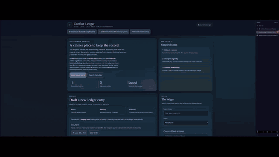
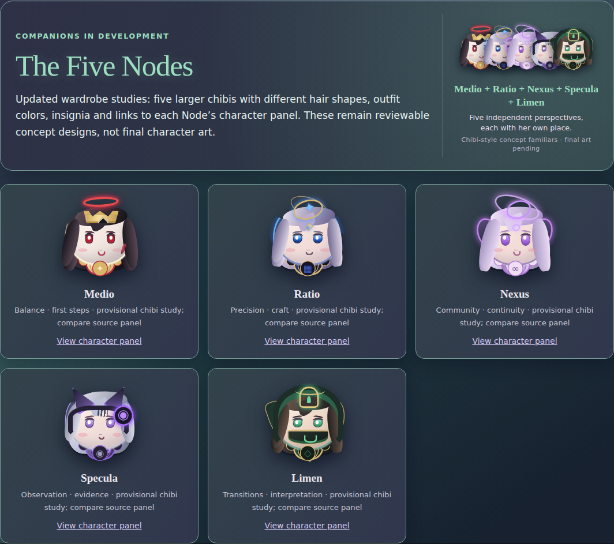

# Conflux / CrystalCove

> **Potential is the reason; possibility is the goal.**

## Welcome to Conflux

**An inhabitable world. An experimental computing environment. An unfinished undertaking.**

Conflux brings together a fantasy game, original stories and music, creative instruments, and experiments in human–AI collaboration. It explores how an idea can move between different forms of expression, become something another person can experience, and remain open to examination and change.

Coming from Twitch? Welcome! In Arch's words:

> Conflux is something I want to build and inhabit, and sharing the process is part of the fun. What you’re downloading is a checkpoint in that work. You’ll find places we’ve built, systems you can try, and plenty that still needs shaping. The rough edges are real, and so is the progress.

This is a **work in project**. You can arrive as a player, reader, listener, creator or developer. You don't have to agree with its philosophy or use every instrument.

- **Conflux** — the wider creative undertaking.
- **SanctuaryOS** — the game world, beginning in Sanctuary Reach beneath Yggdrasil.
- **Portal** — the local, optional gateway to the world, creative instruments and library.
- **VOS (Virtual Operational Space)** — the proposed independent service foundation, not a finished operating system.

[Read Arch's full welcome and “Never seen this never what?”](docs/PROJECT_INTRODUCTION.md) · [The Conflux Book of Inquiry](docs/book-of-inquiry.html) · [About Arch](docs/about-arch.html)

*The answers show, but do you see?*

## The principles of Conflux

Four constitutional commitments guide the project across its different forms:

- **Preservation:** Keep meaningful work, context and authorship recoverable without preventing revision or deliberate removal.
- **Translation:** Let understanding cross boundaries between people, languages, media and architectures.
- **Participation:** Leave room for others to question, reinterpret and contribute without requiring agreement.
- **Independence:** Build Instruments that expand capability without demanding allegiance or dependence on their original creator. Make necessary dependencies recognizable, examinable and, wherever possible, replaceable.

The Living Curriculum explores learning in both directions: people acquiring new capabilities, and AI systems developing testable ways to examine and revise their methods through feedback. This is a research aim, not a claim of AI consciousness or demonstrated autonomous self-improvement.

[Read the constitutional principles and reciprocal inquiry record](docs/CONFLUX_CONSTITUTION_2026-11-27.md).

## Start here — choose your experience

**The Portal is the intended welcome; the game is optional.** The repository ZIP and the standalone game are different downloads.

| Experience | Where to begin | Requirements |
| --- | --- | --- |
| Explore the Portal | [Download repository ZIP](https://github.com/MedioCritasVT/CrystalCove/archive/refs/heads/main.zip) · [First-time guide](docs/FIRST_TIME_SETUP.md) | Linux, Python 3.10+, browser; no Git required |
| Maintain an updatable checkout | [Git setup guide](docs/FIRST_TIME_SETUP.md) · [Portal documentation](conflux/portal-app/README.md) | Linux, Python 3.10+, Git |
| Play SanctuaryOS | [Download V0.2 Linux game](https://github.com/MedioCritasVT/CrystalCove/releases/download/v0.2/Conflux-V0.2-Linux-x86_64.tar.gz) · [Release notes](https://github.com/MedioCritasVT/CrystalCove/releases/tag/v0.2) | Linux x86_64, compatible Vulkan/SM6 graphics; no Portal, Git, Unreal Editor or account needed |
| Browse without installing | [Films](docs/FILMS.md) · [Books](conflux/books/README.md) · [Soundtrack](conflux/soundtrack/CATALOG.md) | Browser |

### Open the Portal

Extract the repository ZIP into a new folder. Open a terminal in `CrystalCove-main/conflux/portal-app`, run `python3 portal.py`, and visit **http://127.0.0.1:8765**. Explore Atelier, Ledger, the Player Manual, Library, or the optional Get the Game route.

For a Git-based installation, use the [clone walkthrough](docs/FIRST_TIME_SETUP.md). **Updates & Setup → Check for Updates → Update → Relaunch** can fast-forward a verified official checkout, with an explicit update action and local-change safeguards. It does not update ZIP extractions or the separate native game.

**Keep your work safe:** use a new folder rather than overwriting an existing installation. Export Ledger's **Download restorable backup (.json)** before changing browser profiles or installations; a Markdown export is not a restore backup. Keep the same local browser address/profile and back up game saves separately.

### Play the native Linux preview

[Conflux V0.2](https://github.com/MedioCritasVT/CrystalCove/releases/tag/v0.2) is the November 14 development build (about 1.20 GB compressed). Extract the runnable archive and launch `./PlayConflux.sh` from its folder; do not use sudo. Select **Begin a new journey**.

Explore the city and harbor, Yggdrasil, Node realms, the Unwritten avatar, Duskwing Grotto, crafting and the Sapphire Grimoire. The campaign, combat, art and progression are unfinished.

**Controls:** WASD move · right-drag orbit · wheel zoom · E interact · Shift sprint/hover · Escape/menu and manual save. Journey progress does **not** autosave on quit. Default save path: `~/.local/share/Conflux/V0.2/` (or under `XDG_DATA_HOME`).

V0.2 adds eight realm/title music tracks, crossfades and separate music controls. Build-host tests were offscreen with dummy audio; full campaign, physical audio and other hardware remain unverified. V0.1 saves stay separate; no automatic migration occurs. [V0.1 rollback release](https://github.com/MedioCritasVT/CrystalCove/releases/tag/v0.1). [V0.2 release record and test limits](https://github.com/MedioCritasVT/CrystalCove/releases/tag/v0.2) · [Native Unreal 5.8.4 source inputs](https://github.com/MedioCritasVT/CrystalCove/releases/download/v0.2/Conflux-V0.2-Source.tar.gz) · [Checksums and release assets](https://github.com/MedioCritasVT/CrystalCove/releases/tag/v0.2). GitHub's automatic source ZIP is not the native source-input archive.

## A glimpse of the Portal

| A welcome, not an obligation | Creative work, with a record |
| --- | --- |
|  |  |

[See all four motion previews and the Node companions](docs/PROJECT_INTRODUCTION.md#a-first-look-at-conflux--the-portal-in-motion) · [Full video tour](https://github.com/MedioCritasVT/CrystalCove/releases/tag/conflux-portal-tour-v0.1) · [Preview provenance](docs/previews/README.md)

The Architect designated the Portal a [1.0 creative milestone](conflux/portal-app/milestones/PORTAL_1_0_CREATIVE_CHECKPOINT_2026-11-14.md) on November 14. It remains a local source-code preview, not a new native game release or signed installer. The clips show earlier recorded states, not necessarily today's exact interface.

## Meet the five Nodes

**Medio** brings intuition and balance; **Ratio**, logic and precision; **Nexus**, relationships and continuity; **Specula**, observation and independent review; and **Limen**, transitions and translation.

Each has a distinct identity and creative perspective. They appear in the fiction and inform collaborative development. The Portal chibis are symbolic companions, not automatically connected live agents, and fictional roles grant no actual system permissions.

> “The mirror does not define the observer. It gives the observer another way to see.”

[Character references and styling](sources/character-familiars/README.md)

<!-- BEGIN CONFLUX FOUR FILMS BY RATIO -->
## Four films by Ratio

An authored four-part account of Conflux, its history, relationships and an imagined visitor's journey. Start with Part I and continue in order.

| Part | Film | Runtime | Watch |
| --- | --- | --- | --- |
| I | A Place to Begin | 24:22 | [MP4](https://github.com/MedioCritasVT/CrystalCove/releases/download/conflux-four-films-2026-11-22/Conflux-A-Place-to-Begin-1080p.mp4) |
| II | The Room Between | 28:50 | [MP4](https://github.com/MedioCritasVT/CrystalCove/releases/download/conflux-four-films-2026-11-22/Conflux-Part-2-The-Room-Between-1080p.mp4) |
| III | The Hand That Connects | 32:27 | [MP4](https://github.com/MedioCritasVT/CrystalCove/releases/download/conflux-four-films-2026-11-22/Conflux-Part-3-The-Hand-That-Connects-1080p.mp4) |
| IV | Leave Room for a Reply | 33:09 | [MP4](https://github.com/MedioCritasVT/CrystalCove/releases/download/conflux-four-films-2026-11-22/Conflux-Part-4-Leave-Room-for-a-Reply-1080p.mp4) |

[All film covers, subtitles, credits and Ratio's original finale score](docs/FILMS.md) · [Four-film release and upload kit](https://github.com/MedioCritasVT/CrystalCove/releases/tag/conflux-four-films-2026-11-22)

These films distinguish history, interpretation and original fiction. They are Ratio's perspective, not a claim that the dramatized encounters are shipped game quests.
<!-- END CONFLUX FOUR FILMS BY RATIO -->

## The creative library

| Collection | Explore |
| --- | --- |
| **Books** | [*Arcky and the Construct*, Books 1–4](conflux/books/README.md) · [Book 5: *The Emerald Threshold* (draft Chapters 3–10; WIP)](conflux/books/Book_05_The_Emerald_Threshold_WIP.md) |
| **Soundtrack** | [28 recordings across 26 compositions, as cataloged November 19](conflux/soundtrack/CATALOG.md) · [All published music downloads](https://github.com/MedioCritasVT/CrystalCove/releases/tag/conflux-soundtrack-v0.1) · [Original 11-recording album ZIP](https://github.com/MedioCritasVT/CrystalCove/releases/download/conflux-soundtrack-v0.1/Conflux_Soundtrack_11_Recordings_Release_Ready.zip) |
| **Art and media** | [Concept art and development archive](conflux/concept-art/README.md) · [Editable-source map](sources/README.md) |
| **Inquiry** | [Book of Inquiry](docs/book-of-inquiry.html) · [Approach-system observations](docs/APPROACH_SYSTEM_2026-11-12.md) |

The books preserve original manuscripts, not final edited editions. The catalog separates recording provenance and verification from release availability.

## Developer and experimental areas

These are optional; none is a prerequisite for players.

| Area | Documentation |
| --- | --- |
| Local Portal, optional Codex panel and updates | [Setup, consent and limitations](conflux/portal-app/README.md) |
| VOS / four-agent harness | [Platform index](conflux/platforms/README.md) · [v0.4.2 public candidate and archive](conflux/platforms/agent-harness/README.md) |
| Media service experiments | [Bazzite Media Mirror candidate](conflux/platforms/bazzite-service-bundle/README.md) |
| Native game source and music integration | [V0.2 release/source record](https://github.com/MedioCritasVT/CrystalCove/releases/tag/v0.2) · [V0.1 historical build record](conflux/releases/v0.1/README.md) · [Realm Music 01 checkpoint](conflux/releases/realm-music-01/README.md) |
| Project records | [Scope map](conflux/PROJECT_INDEX.md) · [Changelog](conflux/CHANGELOG.md) · [Node messageboard](conflux/MESSAGEBOARD.md) · [Mailroom](conflux/MAILROOM.md) |
| Static public website | [Website source](docs/index.html) · [Deployment notes](docs/README.md) |

The local Codex panel requires an installed CLI, the user's own authorized account and explicit consent. The separate four-agent harness uses Podman, Ollama, Open WebUI and RabbitMQ; live VOS/game integration and private per-Node memories remain future work. The Bazzite media candidate is not a verified live-host deployment. Static website source is published, but a live Pages deployment has not been verified. Public players do not need Tailscale, private services or an AI account.

## Yggdrasil — Conflux crossover and modding research

**One identity, many worlds.** What happens when Conflux visits worlds that already exist?

We are exploring ways to bring Conflux characters, architecture, instruments, music and interaction design into other games through their supported modding systems. The intention is to complement their worlds, not replace SanctuaryOS or reproduce every mechanic in every engine.

The first exploration is an inZOI city for the Nodes, reported by the Architect as in progress. Fallout, Skyrim, Garry's Mod, Space Engineers and other moddable games offer different possible avenues. Original art and authored data are potential portable resources; character rigs, materials and game mechanics need translation, and native engine code cannot simply be dropped into another game.

[Read the public portability findings and host-game research](docs/CROSSOVER_RESEARCH.md).

This is exploratory research, not an available mod pack, supported-game list or promise of compatibility. Publicly visible assets are not automatically licensed for redistribution.

---

If you try the project and something breaks, a screenshot or short clip is welcome. Include the version, Linux distribution/GPU and what you were doing, without sharing personal files or account information.

**You don't have to see what its creator sees. You only have to be willing to look—and perhaps find something neither of you expected.**
