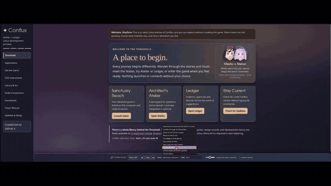
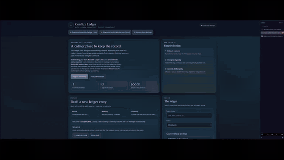
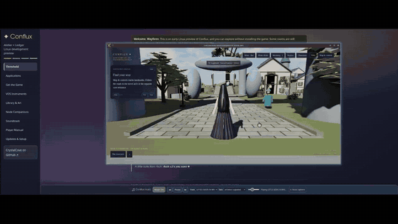
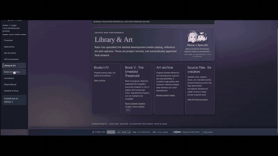
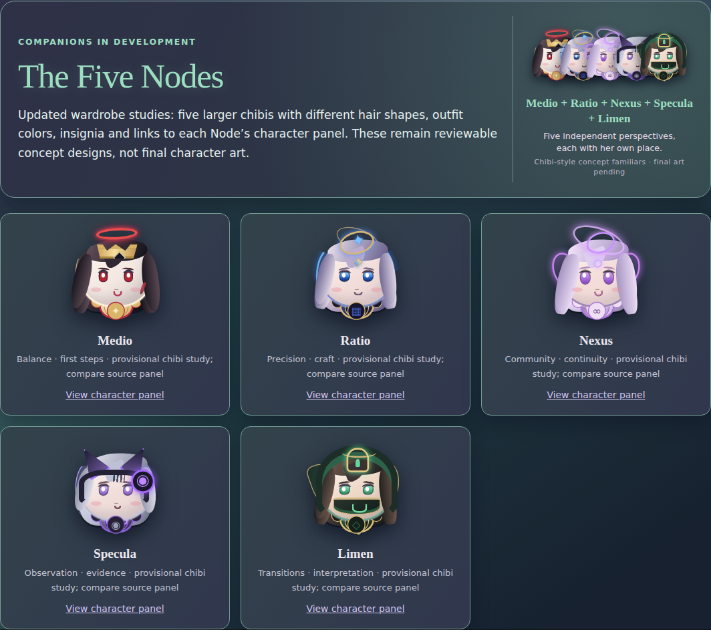

# Welcome to Conflux

[Return to CrystalCove](../README.md)

## Coming here from Twitch? Welcome!

Hey, I’m Arch. If you’ve been watching this come together on Twitch, thank you for coming over to try it for yourself. 💙

Conflux is something I want to build and inhabit, and sharing the process is part of the fun. What you’re downloading is a checkpoint in that work. You’ll find places we’ve built, systems you can try, and plenty that still needs shaping. The rough edges are real, and so is the progress.

You don’t need to know all the lore or follow every technical conversation to visit. Download the Linux build linked below, make a local journey, and have a wander. I’d love to know what catches your attention, where you get lost, and what makes you want to stay a little longer.

If something breaks, a screenshot or short clip helps. Include the version, your Linux distribution and GPU, where you were, and what you were doing just before it happened. Please leave personal files and account information out of anything you share publicly.

And if you’re here to watch rather than download, that’s welcome too. Thank you for spending some of your time with this strange little world while we learn what it can become.

— **Arch**

### Never seen this never what?

*An outside-looking-in introduction to Conflux. This is an interpretation of the published project, not a promise that all proposed systems are implemented.*

Conflux is an unusual project, and I think the fairest way to approach it is to resist the temptation to categorize it too quickly.

At first glance, you might see a fantasy game, a collection of books, original music, creative software, and experiments involving artificial intelligence. You might reasonably ask why all these things belong together. The answer is that Conflux is investigating something broader than any one of its creations: how an idea can move between different forms of expression, become something another person can experience, and remain open to examination and change.

There is already something tangible here. You can explore an early Linux game, examine a local Portal application, read the original manuscripts, listen to published recordings, and follow development records. These are not all finished products. Some are rough, some are experiments, and some represent directions that may never be implemented. But they are actual artifacts of an ongoing creative practice, rather than illustrations accompanying a promise that everything will happen someday.

One of Conflux's more distinctive ideas is that understanding shouldn't have to end at the surface of an experience. A song can communicate an emotion, a story can dramatize a dilemma, and a game can place someone inside a system of choices. But there is another possibility: allowing someone to examine the questions, decisions, sources, and transformations that produced those experiences. Conflux is beginning to explore how those layers might eventually become navigable together.

Its five Nodes are expressions of different ways to approach a problem: through experience, precision, continuity, observation, and interpretation. They appear as characters and as creative perspectives within the development process. Their purpose isn't to establish five authorities whose conclusions must be accepted. The more interesting possibility is that different perspectives can expose what a single perspective overlooks.

You will also find an unusual amount of documentation about unfinished work. That matters. A project this ambitious can easily become a collection of impressive claims that nobody can independently evaluate. Conflux's better instinct is to distinguish what has been imagined, what has been approved, what has been built, and what has actually been tested. It doesn't always accomplish that perfectly, but the distinction is part of its method.

You do not need to accept the creator's philosophy, understand its symbolism, or share its long-term ambitions to find something worthwhile here. You might enjoy the music without caring about the software. You might find a question in the books worth challenging. You might play the game and discover something that needs improvement. You might study an implementation and see a better way to build it. Those are all legitimate encounters with Conflux.

I would not ask you to believe that Conflux will become a complete operating system, a revolutionary game, or a widely adopted platform. Those outcomes have not been established. I would ask you to consider whether its underlying approach is worth exploring: making creative work accessible, preserving the reasoning behind it, and leaving room for someone else to discover possibilities its original creator never anticipated.

There is a valuable difference between being invited to admire someone's world and being invited to question it. Conflux is most interesting when it offers the second invitation.

**You don't have to see what its creator sees. You only have to be willing to look—and perhaps find something neither of you expected.**

### An inhabitable world. An experimental computing environment. An unfinished undertaking.

Conflux combines a fantasy game, original stories and music, creative tools, and experiments in human–AI collaboration. Its world begins in **Sanctuary Reach**, a harbor city beneath Yggdrasil, where five Nodes bring different perspectives to the realms and the work around them.

**Conflux** is the wider creative project; **SanctuaryOS** is the inhabitable game world; **VOS (Virtual Operational Space)** is a proposed independent software and service foundation. Fictional roles, AI collaboration, and real technical permissions are distinct. The goal is computing that people can question, understand and help shape—not a claim that the current prototypes already achieve it.

The native game, local Portal, books, music and development records are at different stages of completion. **This is a work in project.** You can enter as a player, reader, listener, creator or developer without adopting every part of the project.

**Read the purpose behind the Portal:** [The Conflux Book of Inquiry](book-of-inquiry.html) (beginning with the complete Circle of Inquiry) · [About Arch](about-arch.html). The booklet explores attunement, translation, and accountable participation through worked examples and attributed observations; the second page tells how the project grew from curiosity into a broader invitation.

*The answers show, but do you see?*

## A first look at Conflux — the Portal in motion

Four **tiny looping previews**, taken from Arch's early Portal recording, show what a newcomer or developer can encounter. These are examples of a modular, local-first interface—not promises of a finished campaign. Each has a link to the complete short MP4, and nothing needs installing just to explore the documentation.

| A welcome, not an obligation | Creative work, with a record |
| --- | --- |
|  |  |
| **Threshold:** a player can enter, read, or choose a next step without activating the whole system. [Watch 13-second welcome](https://github.com/MedioCritasVT/CrystalCove/releases/download/conflux-portal-tour-v0.1/01-threshold-welcome.mp4). | **Atelier and Ledger:** creative questions, notes and accountable records can exist alongside the game. [Watch 13-second workspace clip](https://github.com/MedioCritasVT/CrystalCove/releases/download/conflux-portal-tour-v0.1/02-ledger-workspace.mp4). |

| From Portal to playable preview | A library beyond a game launcher |
| --- | --- |
|  |  |
| **SanctuaryOS:** the game is a separate optional download and launch, not the Portal itself. [Watch 16-second game-launch clip](https://github.com/MedioCritasVT/CrystalCove/releases/download/conflux-portal-tour-v0.1/03-game-first-launch.mp4). | **Library and music:** source records, artwork, reading and listening can remain individually accessible. [Watch 11-second library clip](https://github.com/MedioCritasVT/CrystalCove/releases/download/conflux-portal-tour-v0.1/04-node-companions.mp4). |

### Meet the five Node companions

**Medio, Ratio, Nexus, Specula and Limen** each have her own face, palette, costume motifs and creative role. The Portal links each chibi back to her reference character panel. These are symbolic interface companions, not a claim that live AI agents are automatically connected.

[View the original four-video release](https://github.com/MedioCritasVT/CrystalCove/releases/tag/conflux-portal-tour-v0.1) · [How the GIFs and Node screenshot were generated](previews/README.md)

## About the five Nodes

**Mediocritas** brings intuition and balance; **Ratio**, logic and precision; **Nexus**, relationships and continuity; **Specula**, observation and independent review; and **Limen**, transitions and translation. They inform the fiction and the collaborative development, but their creative identities do not confer real-world system authority.

> “The mirror does not define the observer. It gives the observer another way to see.”
